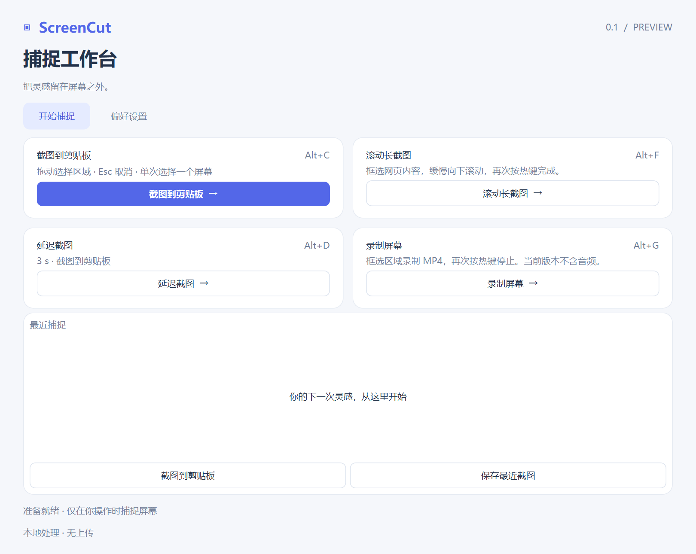

# ScreenCut

A local-first Windows capture studio: screenshots, scrolling captures, delayed captures and MP4 recording in one quiet desktop app.

**录制声音：** 扬声器图标控制默认播放设备的系统声音，麦克风图标控制默认输入设备的讲话声音。开始前分别选择开关；点击工具条“···”可在录制前或录制中调整两路录制音量（0% 静音、100% 原音量、200% 放大），不改变系统播放音量。默认系统声音开启、麦克风关闭。系统声音包含默认设备播放的所有应用；换耳机或输出设备后请重新开始录制。麦克风增益也会放大背景噪声。

新版：偏好设置支持浅色／深色／跟随系统，录屏目标帧率 5–120 FPS，高清或无损 RGB 4:4:4。无损模式文件较大；部分播放器对 RGB H.264 支持有限。停止录屏后弹出保存对话框，取消则保留默认目录中的录屏。紧凑工具条默认位于左上角，可右键隐藏，Alt+G 恢复。80ms 滚动采样仍需保留画面重叠与短暂停顿。

**状态 / Status: v0.1.0 preview.** 已有可运行桌面程序，不是仅界面原型。滚动截图为手动滚动、自动拼接，暂不自动驱动网页滚动。



## 使用 / Usage

双击桌面 **ScreenCut**，或运行 `dist/ScreenCut/ScreenCut.exe`。关闭主窗口后继续在系统托盘运行；右键托盘 → 退出，才会完全退出。

| 默认快捷键 | 行为 |
| --- | --- |
| Alt+C | 框选屏幕区域，截图复制到剪贴板 |
| Alt+V | 向当前应用发送 Ctrl+V，粘贴当前剪贴板 |
| Alt+A | 重新框选截图，弹出 PNG 保存对话框；以设置的默认目录为初始位置 |
| Alt+F | 开始滚动截图；再次按下完成并复制到剪贴板 |
| Alt+G | 打开/重新显示录屏控制窗；在控制窗中开始或停止 |
| Alt+D | 按设置延迟后框选截图（默认 3 秒，可设 0–60 秒） |

所有组合键都能在 **偏好设置** 中直接按键录入，清空可禁用。支持 Ctrl/Alt/Shift/Win 与字母、数字、F1–F24 组合（Windows 保留的 F12 除外）。热键被 PixPin 等软件占用时显示冲突，请修改键位或自行退出占用程序。软件不会抢占或关闭其他程序。

**滚动截图操作：** 打开网页 → Alt+F → 只框选正文，排除固定页眉、侧栏和滚动条 → 缓慢向下滚动，每次移动不超过选区高度约一半 → 每次停留约 1 秒 → 再按 Alt+F 完成 → Alt+V 粘贴，或 Alt+A 保存。

如果提示无法匹配，请回滚到上次成功位置，再以更小步幅滚动。无可靠重叠时会拒绝追加，以避免重复或缺失内容。纯色页面、大块重复图案、视频、动画、懒加载造成布局跳变、粘性页眉以及横向滚动尚不保证拼接。长图上限约 7000 万像素。

**语言：** 简体中文 / English / Français / Español / 한국어 / 日本語。选择语言后点击保存设置，无需重启。

**录屏：** 控制窗默认全屏，可点击“选择区域”改为区域录制。麦克风按钮未选中为静音、选中为录制默认麦克风，须在开始前设置；当前不录系统声音。点击开始/停止，窗口显示录制时间；右键隐藏，Alt+G 重新显示而不停止录制。H.264 MP4，5–30 FPS；高分辨率性能依硬件而定，不要在保存完成前强制结束进程。

**选区：** 拖选时显示物理像素尺寸。边框默认蓝色，可在偏好设置修改颜色。

截图与录屏默认保存到用户的 `Pictures/ScreenCut`；可自选文件夹。设置与运行日志位于 `%APPDATA%/ScreenCut/`。软件不联网、不上传屏幕内容。

## 开发 / Development

Windows 10 2004+ / Windows 11，独立 CPython 3.13 x64（避免 Anaconda Qt DLL 冲突）。

```powershell
python -m venv .venv
.\.venv\Scripts\python.exe -m pip install -r requirements.txt
.\.venv\Scripts\python.exe run.py
.\.venv\Scripts\python.exe -m unittest discover -s tests -v
.\.venv\Scripts\python.exe scripts/smoke.py
```

`scripts/smoke.py` 会显示测试窗口、复制测试图像到剪贴板、短暂录制自建测试窗口，结果写入被 Git 忽略的 `artifacts/`。请在解锁且无其他窗口遮挡的桌面执行。

```powershell
powershell -ExecutionPolicy Bypass -File scripts/build.ps1
powershell -ExecutionPolicy Bypass -File scripts/desktop-shortcut.ps1
```

打包后的整个 `dist/ScreenCut` 文件夹必须一起分发，不可只复制 EXE。第三方库许可证保存在发行依赖中；对外发布安装包前应完成许可证清单、签名与安装器工作。

## AI 继续开发

先阅读 [AGENTS.md](AGENTS.md)、[开发状态](docs/STATUS.md)、[开发日志](docs/DEVLOG.md) 和 [架构说明](docs/ARCHITECTURE.md)。每次修改后更新日志，明确已验证内容和仍待验证内容。

## 当前边界

- 单次选区位于一个显示器；不支持跨屏拖选。当前机器的 150% 缩放实机采集验证通过；混合缩放、多显示器、HDR 和受保护窗口需要继续专项测试。
- 粘贴目标需支持图片粘贴。Windows 不允许普通权限程序向某些管理员窗口注入输入；此时使用目标应用原生 Ctrl+V。
- 尚无标注编辑器、OCR、GIF、系统音频、自动滚动、历史库或自动更新。本机已设置 ScreenCut 开机启动，并禁用 PixPin 的开机任务。
- 后续开发应优先强化网页滚动鲁棒性、异常恢复与录制性能，再扩展附加功能。
